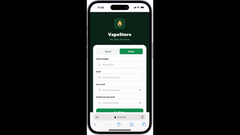
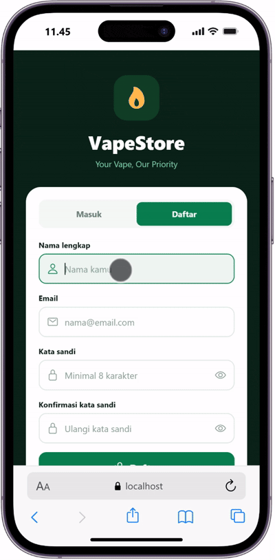
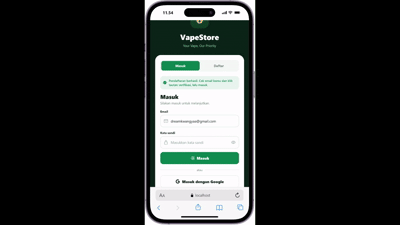
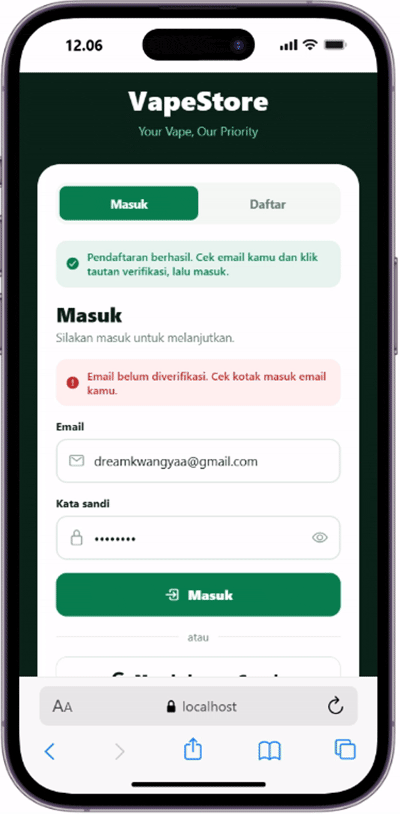
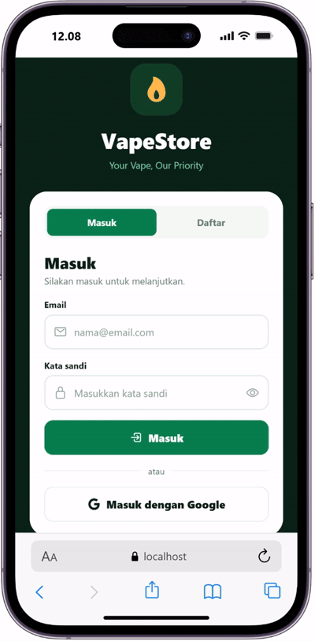
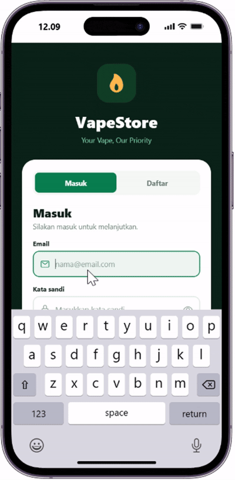
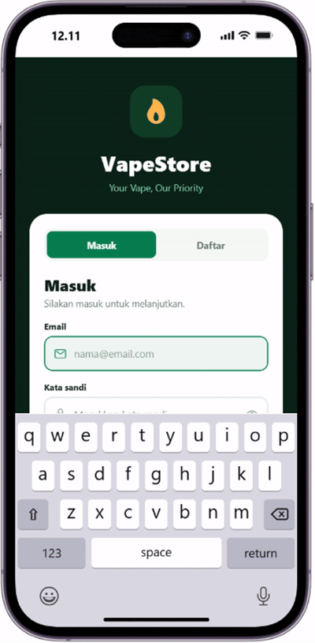
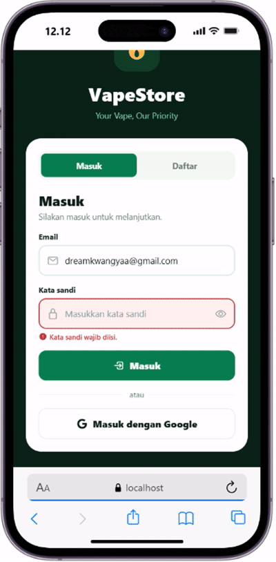
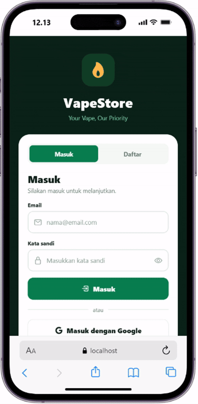

# Laporan Praktikum Pertemuan 10

## Anggota Kelompok

1. Wahyu Ramdhani (2488010037)
2. Khajizatu Sidqiyah (2488010044)
3. Muhamad Zaki Abdul Khair (2488010053)
4. Faqih huddin SM (2488010061)
5. Naula Alfiyatul Fauziyyah (2488010063)

# Login & Register dengan Supabase Auth + Google OAuth

## Studi Kasus: Vapestore

# Hasil Uji Coba End-to-End

## Daftar pelanggan baru (nama, email, password minimal 8 karakter)

## Daftar dengan email yang sudah terdaftar

## Login pelanggan sebelum verifikasi

## Verifikasi lewat link di email, lalu login

## Login owner: akan ke dashboard owner

## Login karyawan: akan ke dashboard karywan

## Kolom kosong 

## Password salah

## Akun yang dinonaktifkan owner mencoba login

