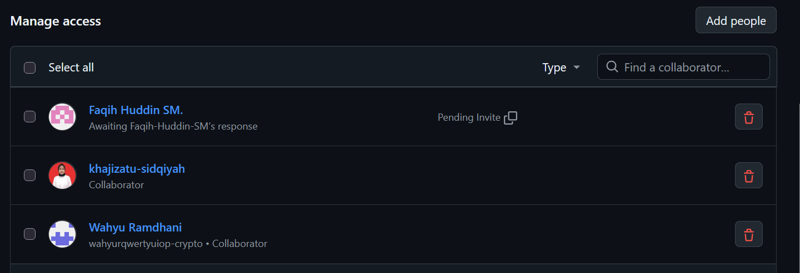
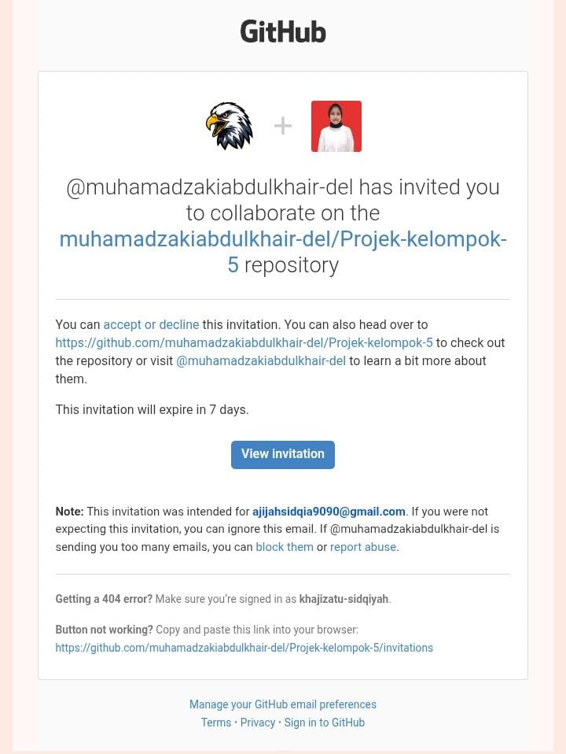
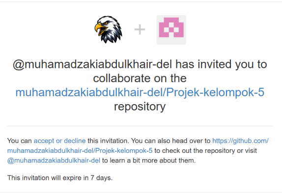
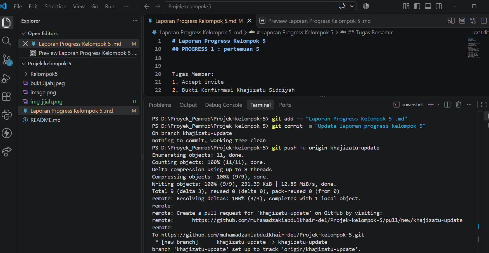

# Laporan Progress Kelompok 5

## Anggota Kelompok

1. Wahyu Ramdhani
2. Khajizatu Sidqiyah
3. Muhamad Zaki Abdul Khair
4. Faqih huddin SM

## PROGRESS 1 : pertemuan 5

1. pm membuat repository dan invite member
2. konfirmasi bukti colab
   

3. pm membuat inisiasi proyek
4. konfirmasi bukti

Tugas Member:

1. Accept invite
2. Bukti Konfirmasi Khajizatu Sidqiyah
   

- clone project
- bukti konfirmasi khajizatu sidqiyah
<<<<<<< HEAD
  
=======

>>>>>>> 31f350088b28c63ccd547b39acb759cc61b12984

3. Bukti konfirmasi Wahyu Ramdani

- clone project
- bukti konfirmasi Wahyu Ramdani

4. Bukti konfirmasi Faqih Huddin SM
<<<<<<< HEAD

### Progress 1: Pertemuan 5

1. PM membuat repository dan invite member
2. Konfirmasi Bukti -> ss bagian colaborators
3. PM membuat inisiasi Proyek
4. Konfirmasi bukti
   buka terminal, ketik npx create-expo-app@latest lalu isi nama proyeknya (misal kelompok6) dan enter. jika sudah selesai masuk ke cd kelompok6 -> npm run web
   WAJIB BAGI PM/mirorring dari hp pun bolehhh: install bluestacks 5 -> buka lalu login gmail -> search expo go dan install -> buka lalu copy bagian metro dari vscode dan paste di bagian url di expo go -> record utk konfirmasi bukti (convert videonya jadi gif)
=======
- clone project
- bukti konfirmasi Faqih Huddin SM

## Tugas Bersama: ##
1. Diskusi Penentuan Tema (notulen diskusi)

>>>>>>> 31f350088b28c63ccd547b39acb759cc61b12984
