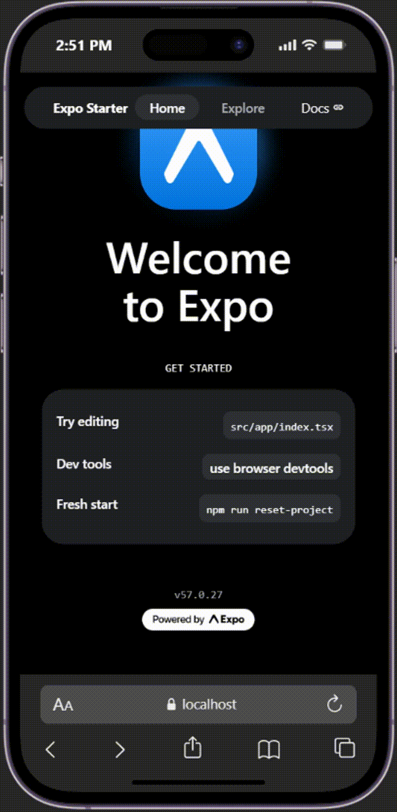
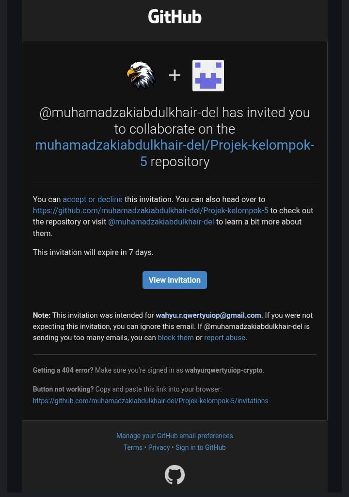
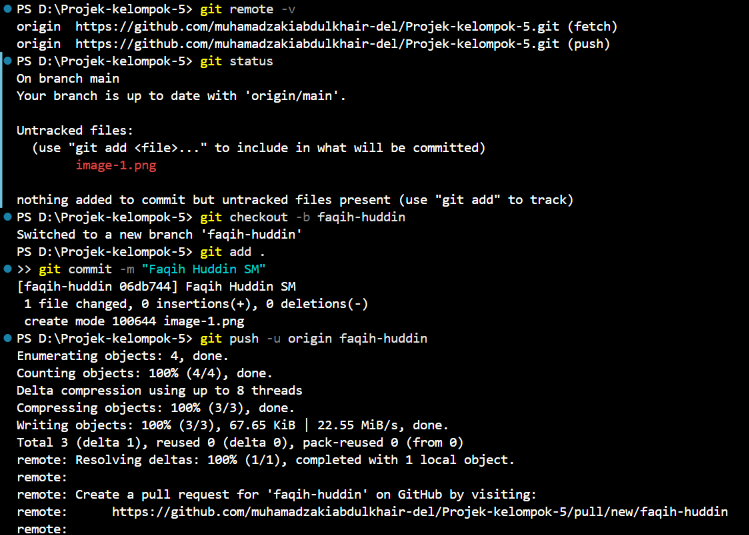

# Laporan Progress Kelompok 5

## Anggota Kelompok

1. Wahyu Ramdhani (2488010037)
2. Khajizatu Sidqiyah (2488010044)
3. Muhamad Zaki Abdul Khair (2488010053)
4. Faqih huddin SM (2488010061)

## PROGRESS 1 : pertemuan 5

1. pm membuat repository dan invite member
2. konfirmasi bukti colab

   

3. pm membuat inisiasi proyek
4. konfirmasi bukti

Tugas Member:

1. Accept invite
2. Bukti Konfirmasi Khajizatu Sidqiyah

   
- clone project
- bukti konfirmasi khajizatu sidqiyah

3. Bukti konfirmasi Wahyu Ramdani
- clone project
- bukti konfirmasi Wahyu Ramdani

4. Bukti konfirmasi Faqih Huddin SM
  
      
 -  clone project
 - bukti konfirmasi Faqih Huddin SM
   
   

## Tugas Bersama: ##
1. Diskusi Penentuan Tema (notulen diskusi)
  Tema: Sistem Vapestore Berbasis mobile.

