# Laporan Praktikum Pertemuan 9

# Media Penyimpanan: CRUD dengan Supabase (Database + Cloud Storage)

## Studi Kasus: Vapestore

# Hasil Uji Coba End-to-End (Produk)

## Uji 1: Koneksi
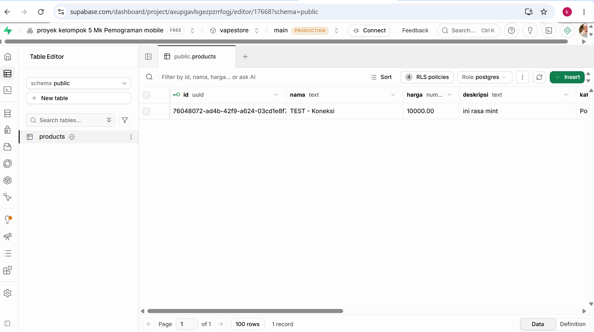

## Uji 2: Buka Manajemen Produk

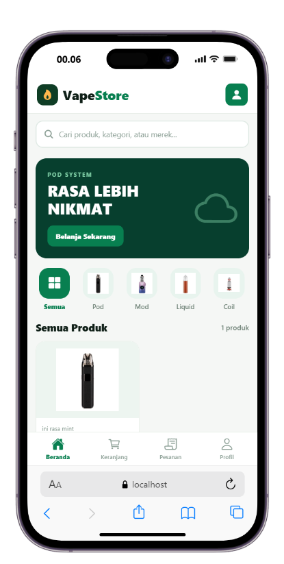

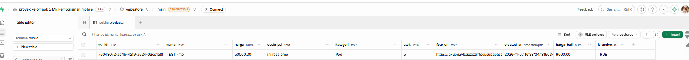

## Uji 3: Tambah dengan foto

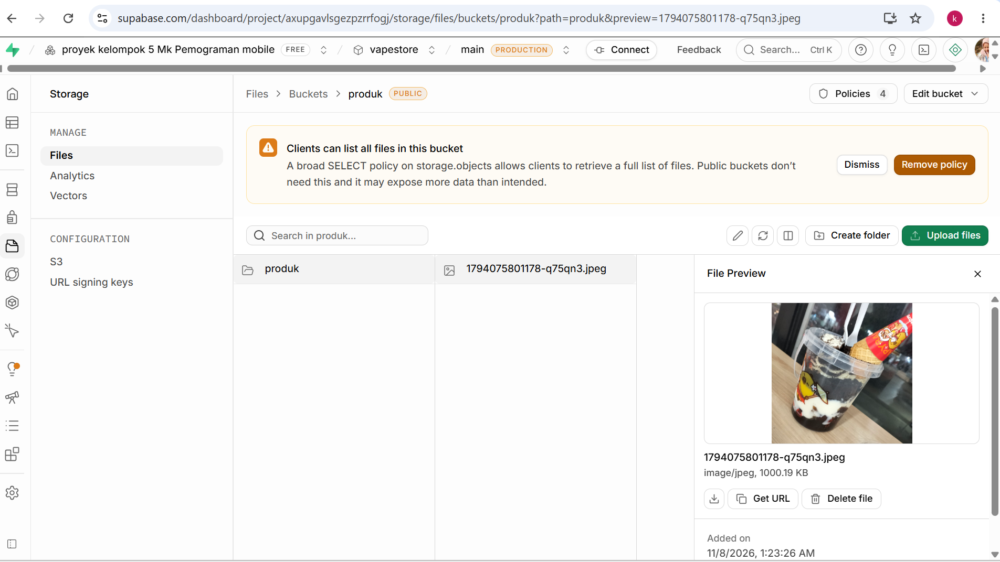

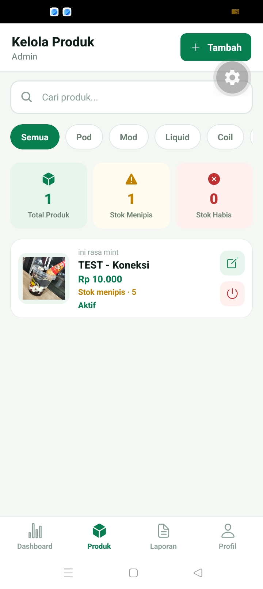

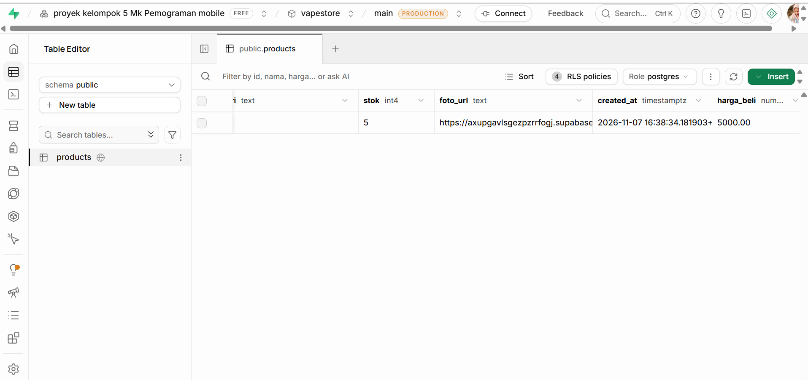

## Uji 4: muncul di layar lain

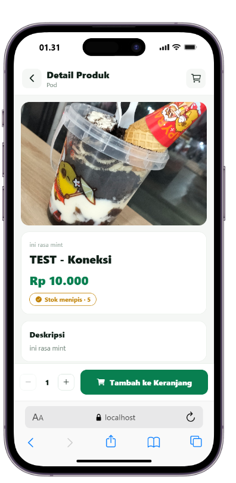

## Uji 5: tambah tanpa foto

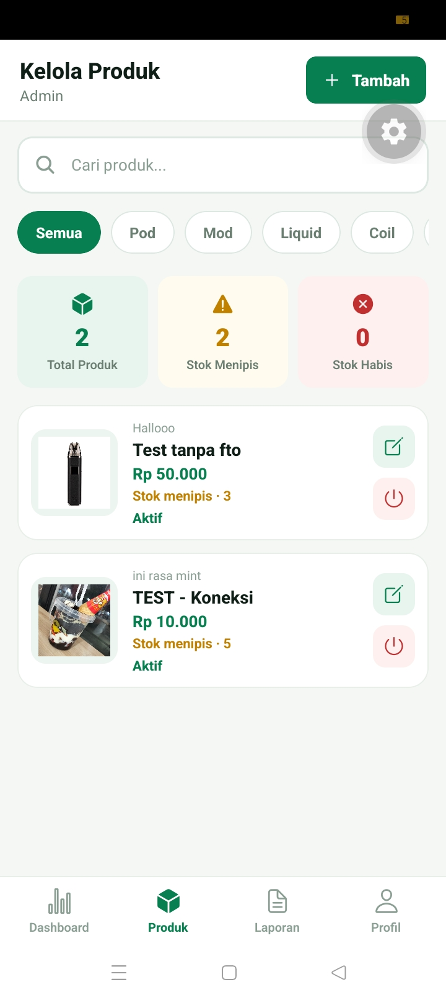

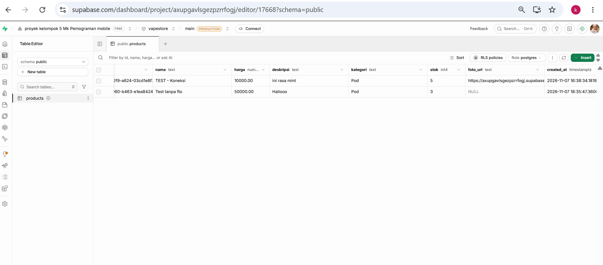

Produk tersimpan tanpa foto. foto_url bernilai NULL dan tidak ada file baru di Storage. Aplikasi menampilkan gambar default sesuai kategori.

## Uji 6: ubah tanpa ganti foto

before edit:

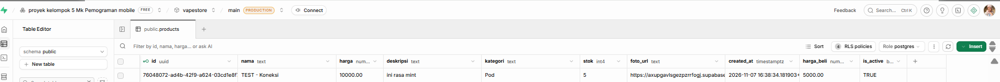

after edit:

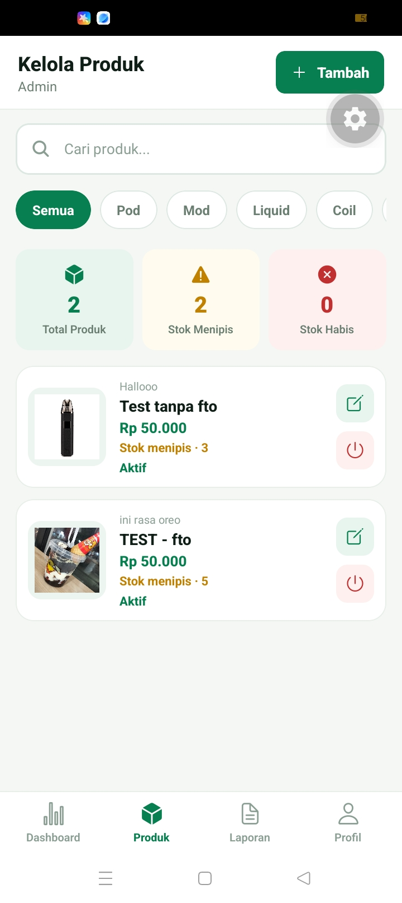

## Uji 6: Ubah dengan ganti foto

- foto baru tampil:

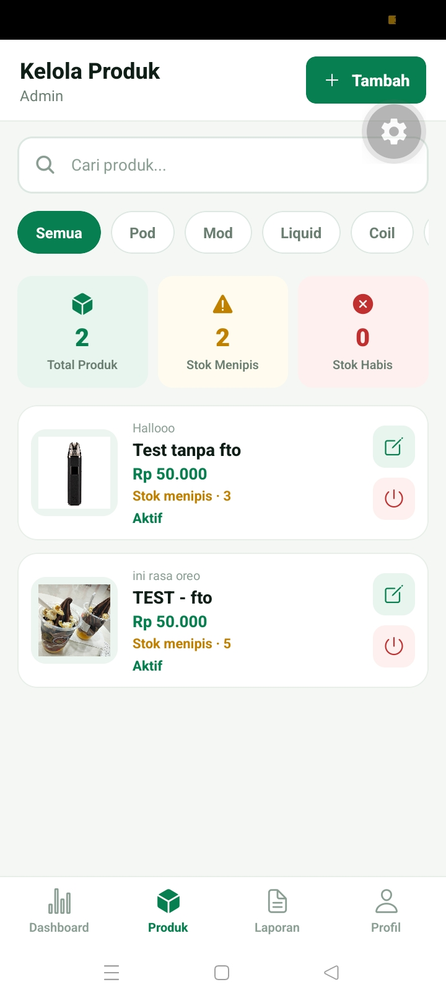

- Storage sebelum 

- Storage sesudah

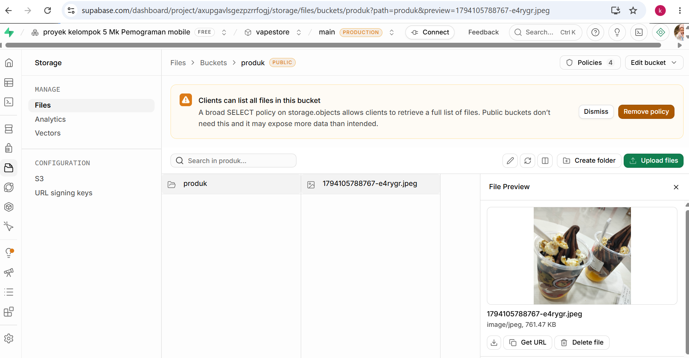

- foto_url lama:

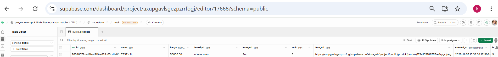

- foto_url baru:

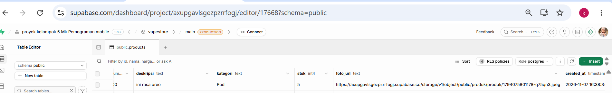

## Uji 8: Nonaktifkan dan aktifkan

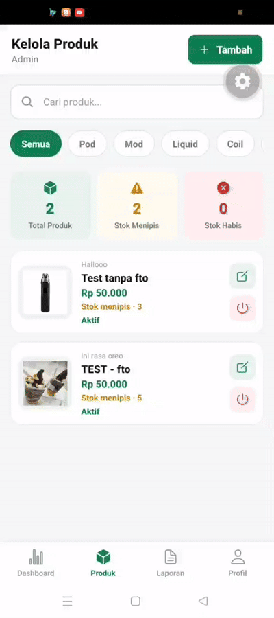

## Uji 9: Validasi

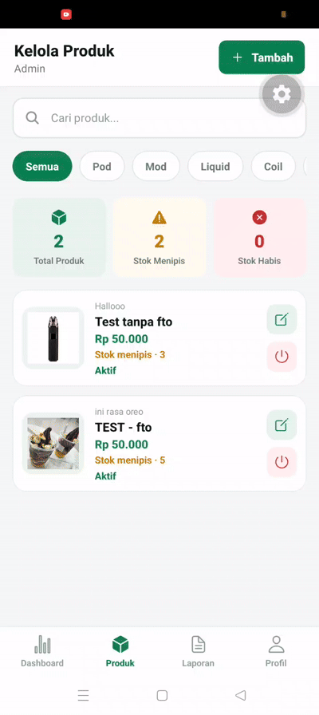

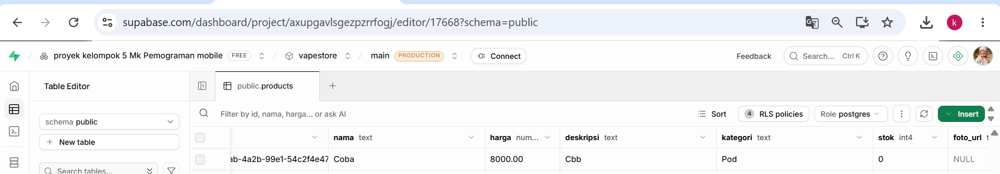

## Uji 10: Bukti Row Level Security (RLS)
Tujuan. Memastikan tabel products dilindungi RLS dan akses dari aplikasi diatur oleh policy.

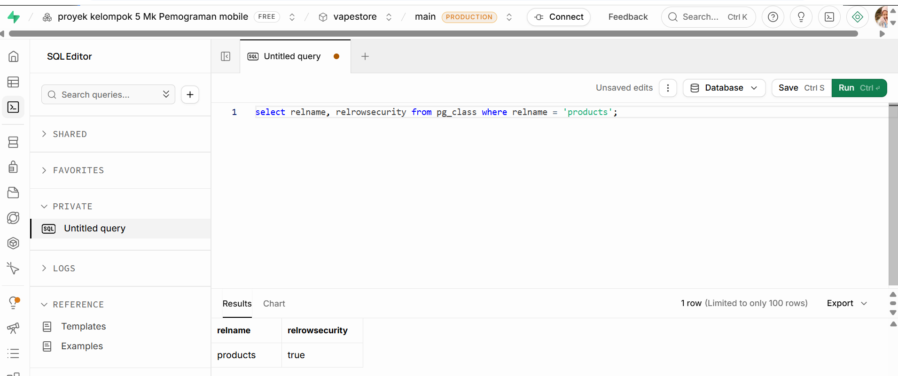

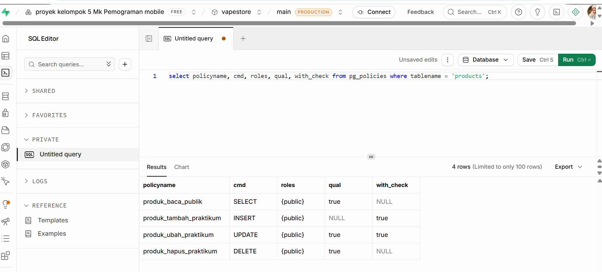

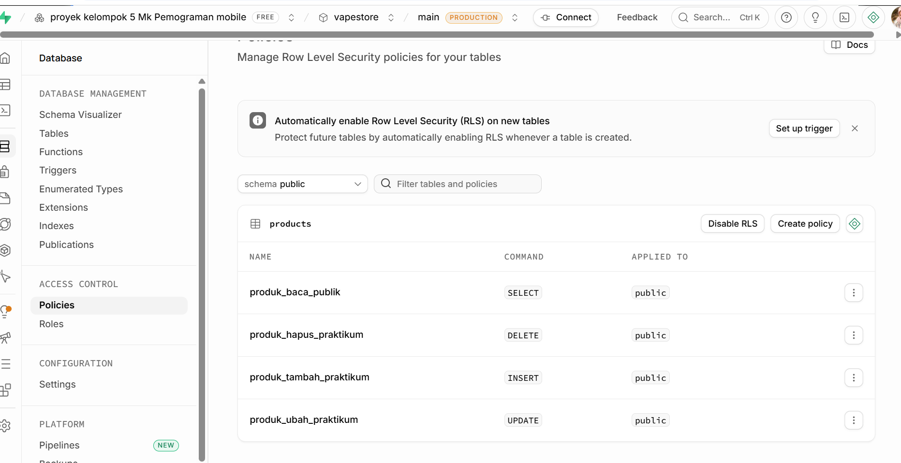

Karena RLS aktif, setiap operasi dari aplikasi (kunci publishable) hanya berhasil jika ada policy yang mengizinkannya. Keempat policy membuka operasi baca, tambah, ubah, dan hapus untuk peran public, sehingga fitur Kelola Produk dapat membaca, menambah, dan mengubah data. Fitur nonaktifkan produk memakai UPDATE (is_active). Policy DELETE tersedia tetapi tidak dipakai aplikasi karena penghapusan diganti dengan nonaktifkan.

## Uji 11: Persistensi

Tujuannya membuktikan data tersimpan di Supabase, bukan di memori aplikasi, jadi tetap ada setelah aplikasi ditutup dan dibuka lagi.

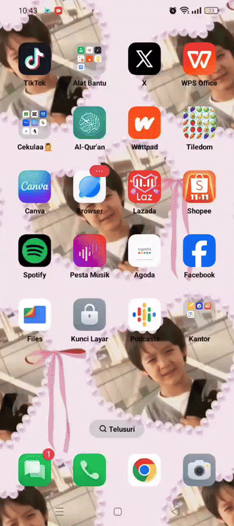

## Uji 12: Cek file yatim

Tujuannya memastikan setiap file di bucket produk dipakai oleh satu produk, dan setiap foto_url menunjuk file yang benar-benar ada. Kerjakan ini sebelum pembersihan produk TEST -. Kalau barisnya dihapus lebih dulu dari Table Editor, filenya jadi yatim karena Table Editor tidak ikut menghapus file di Storage.

- Query 1: file di bucket yang tidak dipakai produk mana pun

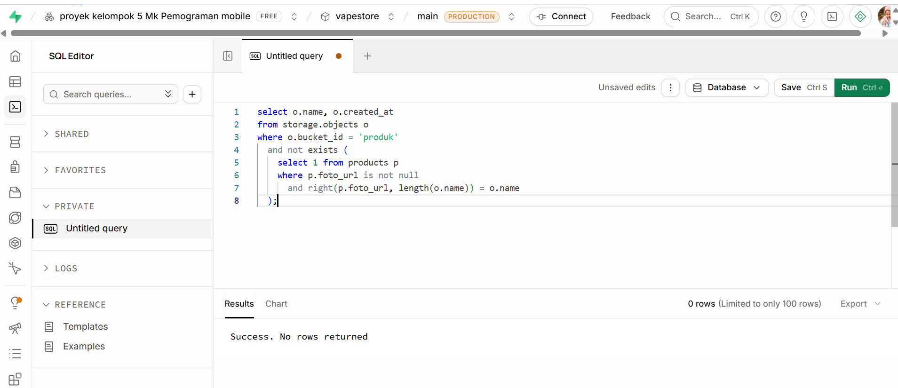

- Query 2: produk yang menunjuk file yang tidak ada

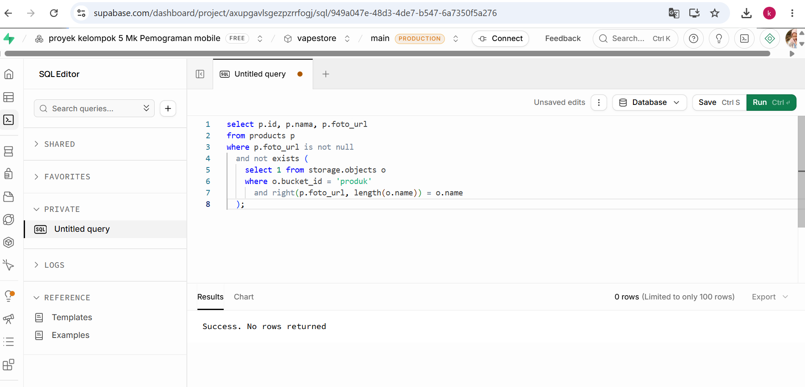

- Query 3: daftar lengkap untuk pembanding

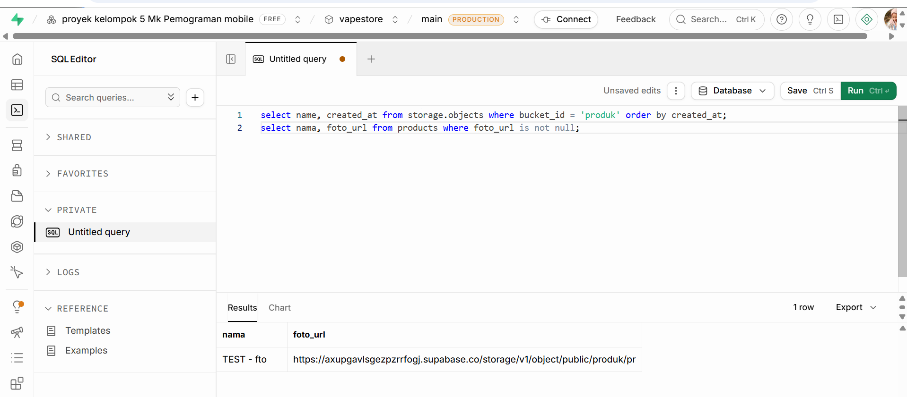

# Hasil Uji Coba End-to-End (Pesanan)

## Uji 1: Read
- Login sebagai pelanggan. Daftar dulu lewat halaman Register (akun hanya tersimpan di memori, jadi hilang saat aplikasi di-restart).
- Buka tab Pesanan.
- Lulus kalau halaman terbuka dengan tulisan “Belum ada pesanan” dan tidak ada error.
- bukti:

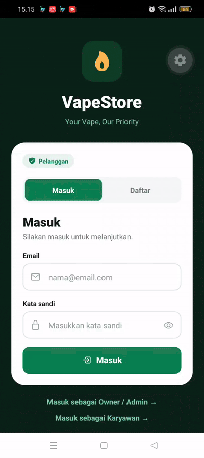

## Uji 2: Create
- Buka produk TEST - fto, lalu Tambah ke Keranjang, lalu Lihat Keranjang.
- Pilih metode pembayaran, lalu tekan Buat Pesanan.
- Lulus kalau:
    - Alert “Pesanan Dibuat” menampilkan nomor INV-1025.
    - Di tab Pesanan, pesanan itu muncul dengan status Menunggu Bayar.
    - Di Supabase Table Editor → orders (klik refresh) ada baris baru: id = INV-1025, customer = Saya, items, total (subtotal + 15.000 ongkir), method, dan status.
- bukti:

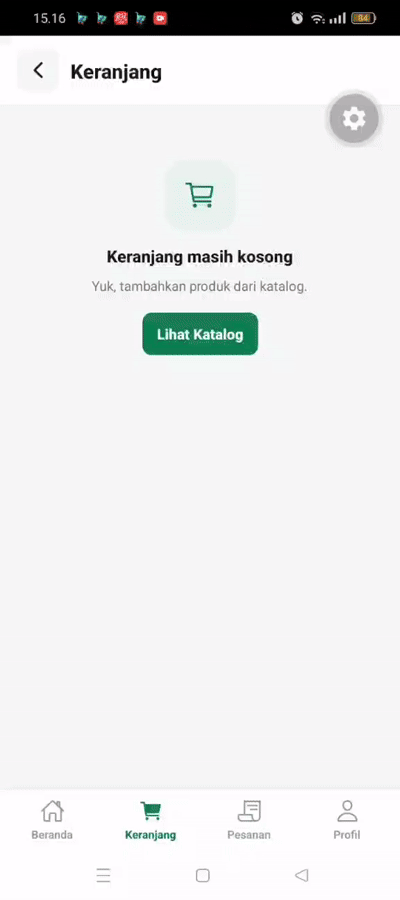

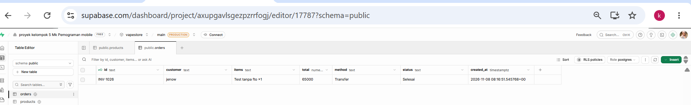

## Uji 3: Update
- Tombol Proses dan Selesaikan hanya tampil untuk peran staf. Di aplikasi, akun pelanggan hanya melihat riwayat.
- Keluar dari akun pelanggan, lalu login sebagai karyawan (karyawan@vapestore.com / karyawan123) atau owner (admin@vapestore.com / admin123). Pilih peran yang sesuai di layar login kalau diminta.
- Buka Pesanan. INV-1025 harus tampil, karena sekarang pesanan dibaca dari Supabase, bukan dari memori akun.
- Tekan Proses, status jadi Diproses. Tekan Selesaikan, status jadi Selesai.
- Lulus kalau kolom status di Table Editor ikut berubah di tiap langkah (refresh dulu). 
- bukti:

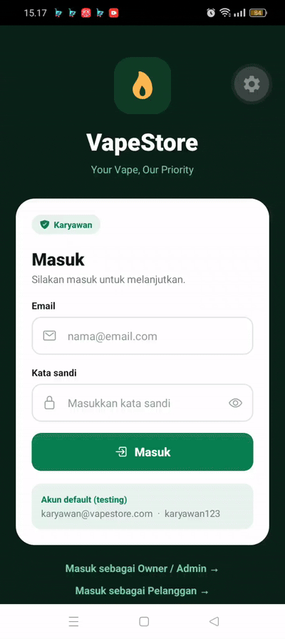

## Uji 4: Persistensi
- Tutup Expo Go sepenuhnya, hentikan Expo dengan Ctrl+C, lalu jalankan npx expo start -c.
- Buka lagi aplikasinya dan login sebagai karyawan.
- Lulus kalau INV-1025 masih ada dengan status terakhir (Selesai).
- bukti:

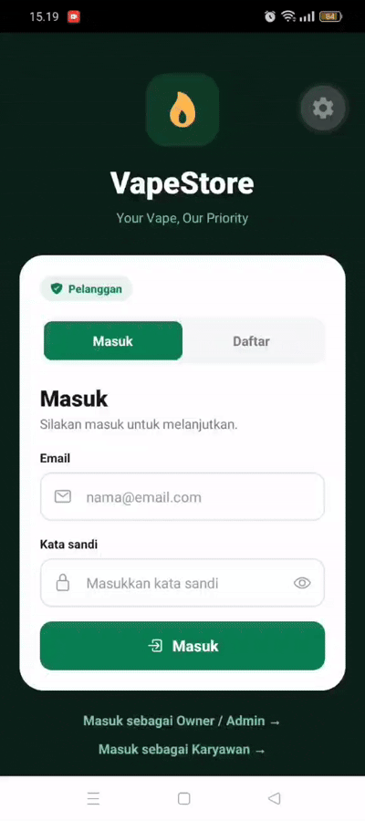
