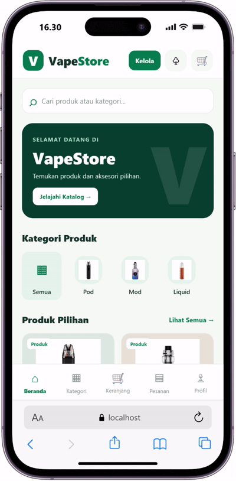
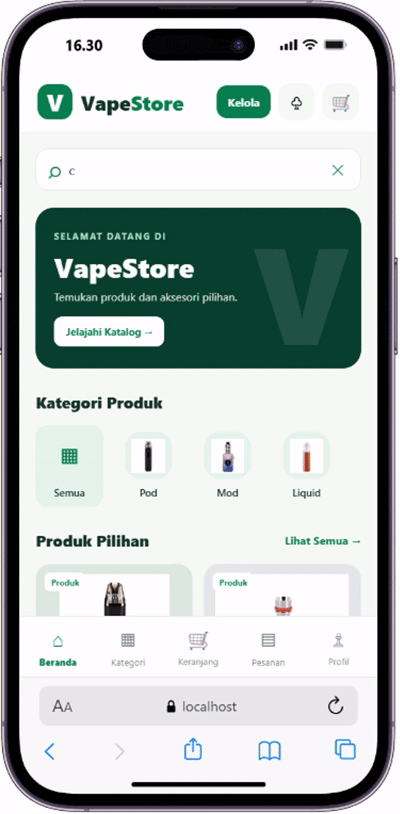
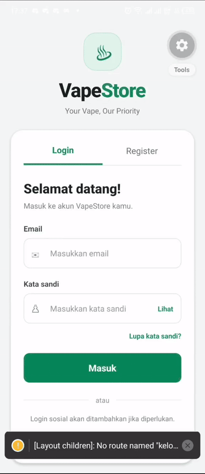
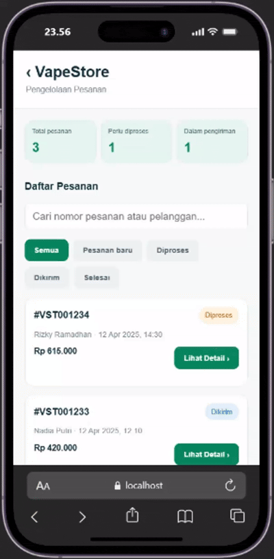
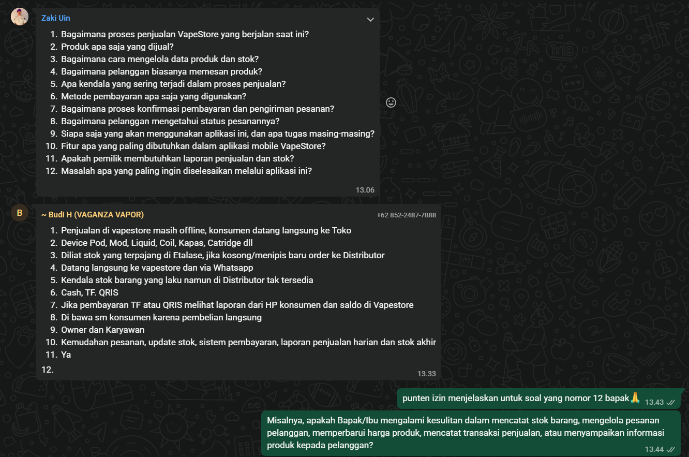
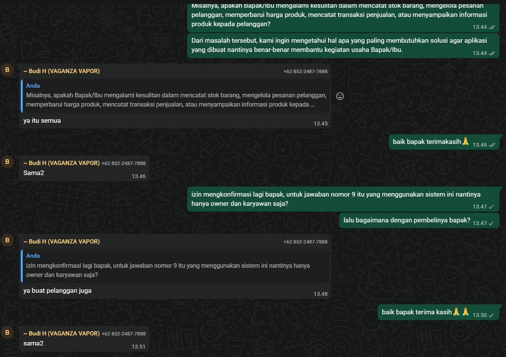

# LAPORAN PROGRESS PENGEMBANGAN APLIKASI MOBILE VAPESTORE

## Tema dan Hasil Wawancara

1. Pendahuluan

   Pengembangan aplikasi mobile VapeStore merupakan proyek yang bertujuan untuk mempermudah proses penjualan produk vape, pengelolaan stok barang, pencatatan transaksi, serta penyusunan laporan penjualan. Aplikasi ini direncanakan untuk membantu pemilik usaha dan karyawan dalam mengelola operasional toko secara lebih efektif dan terorganisasi.
   Sebagai langkah awal dalam pengembangan sistem, tim telah melakukan wawancara dengan pemilik VapeStore untuk mengetahui proses bisnis yang sedang berjalan, kendala yang dihadapi, serta kebutuhan terhadap aplikasi yang akan dikembangkan.
   Hasil wawancara tersebut menjadi dasar dalam menentukan kebutuhan awal dan ruang lingkup pengembangan aplikasi.

2. Tujuan Wawancara

Wawancara dilakukan dengan tujuan:

   - Mengetahui proses penjualan VapeStore yang berjalan saat ini.
   - Mengidentifikasi produk yang dijual dan cara pengelolaan stok.
   - Memahami proses pemesanan dan pembayaran pelanggan.
   - Mengetahui kendala dalam kegiatan operasional toko.
   - Mengidentifikasi kebutuhan pemilik dan karyawan terhadap aplikasi mobile.
   - Menentukan fitur awal yang perlu diprioritaskan dalam pengembangan sistem.

3. Pelaksanaan Wawancara
   Wawancara dilakukan dengan pemilik VapeStore sebagai narasumber. Pertanyaan yang diajukan mencakup proses penjualan, jenis produk, pengelolaan stok, metode pemesanan, pembayaran, pembagian tugas pengguna, dan fitur yang diharapkan tersedia pada aplikasi.
   Selain itu, tim juga menggali kendala yang dialami dalam pengelolaan produk, stok, harga, transaksi penjualan, dan penyampaian informasi produk kepada pelanggan.

4. Hasil Wawancara

   Berdasarkan hasil wawancara, diperoleh beberapa informasi mengenai kondisi operasional VapeStore saat ini.

1. Proses Penjualan

   Penjualan VapeStore masih dilakukan secara offline, yaitu pelanggan datang langsung ke toko. Selain itu, pelanggan juga dapat melakukan pemesanan melalui WhatsApp.
   Produk yang dijual meliputi device pod, mod, liquid, coil, kapas, cartridge, dan berbagai perlengkapan vape lainnya.

2. Pengelolaan Produk dan Stok

   Pengelolaan stok saat ini dilakukan dengan memperhatikan jumlah barang yang tersedia di etalase. Apabila stok barang kosong atau mulai menipis, pemilik atau karyawan akan melakukan pemesanan barang kepada distributor.
   Salah satu kendala yang dihadapi adalah ketika produk yang banyak diminati pelanggan ternyata tidak tersedia di distributor. Kondisi tersebut dapat menghambat pemenuhan permintaan pelanggan.

3. Pemesanan dan Pembayaran

   Pelanggan melakukan pembelian dengan datang langsung ke toko atau menghubungi toko melalui WhatsApp.
   Metode pembayaran yang digunakan saat ini meliputi:

      - Pembayaran tunai (cash).
      - Transfer bank.
      - QRIS.

   Untuk pembayaran melalui transfer bank atau QRIS, pemilik atau karyawan melakukan pengecekan melalui bukti atau informasi pembayaran dari pelanggan dan saldo yang masuk ke rekening atau akun pembayaran toko.
   Pada transaksi langsung, barang dibawa oleh pelanggan setelah pembelian dilakukan.

4. Pengguna Sistem

   Berdasarkan wawancara, pengguna internal yang disebutkan oleh pemilik adalah:

      1. **Owner:** mengelola usaha, memantau stok, melihat transaksi, dan memperoleh laporan penjualan.
      2. **Karyawan:** membantu kegiatan operasional toko, melayani pelanggan, serta mengelola produk dan transaksi sesuai kewenangannya.
      3. **Pelanggan:** yang dimana nantinya pelanggan bisa melihat jenis produk, harga, foto dan sebagainya. selain itu juga pelanggan bisa melakukan checkout dan memilih metode pembayaran serta status pesanan.

4. Kebutuhan Aplikasi

   Pemilik menyampaikan bahwa aplikasi diharapkan dapat memberikan kemudahan dalam:

      - Pengelolaan pesanan pelanggan.
      - Pembaruan data dan stok produk.
      - Pengelolaan pembayaran.
      - Pembuatan laporan penjualan harian.
      - Pemantauan stok akhir.

   Pemilik juga menyetujui bahwa terdapat kendala dalam pencatatan stok, pengelolaan pesanan, pembaruan harga produk, pencatatan transaksi, serta penyampaian informasi produk kepada pelanggan.

6. Progress Pengembangan Saat Ini

   Pada tahap ini, pengembangan aplikasi masih berada dalam tahap awal, yaitu pengumpulan informasi dan analisis kebutuhan pengguna.
   Progress yang telah dilakukan meliputi:

      1. Melakukan persiapan wawancara dengan pemilik VapeStore.
      2. Menyusun daftar pertanyaan terkait proses bisnis dan kebutuhan aplikasi.
      3. Melaksanakan wawancara untuk mengetahui proses operasional toko.
      4. Mengumpulkan informasi tentang penjualan, produk, stok, pemesanan, dan pembayaran.
      5. Mengidentifikasi kendala yang dialami pemilik dalam kegiatan operasional.
      6. Menyusun kebutuhan awal dan gambaran fitur yang akan dikembangkan.

   Dengan demikian, hasil yang telah dicapai saat ini adalah terkumpulnya informasi awal sebagai dasar pengembangan sistem. Desain antarmuka, rancangan database, implementasi aplikasi, dan pengujian belum dinyatakan selesai pada tahap ini.

7. Kesimpulan

   Berdasarkan hasil wawancara dengan pemilik VapeStore, diketahui bahwa proses penjualan saat ini masih dilakukan secara offline dan melalui WhatsApp. Pengelolaan stok, pembaruan harga, pencatatan transaksi, pengelolaan pesanan, serta penyampaian informasi produk masih menjadi beberapa kendala yang perlu diperhatikan.
   Pemilik mengharapkan aplikasi mobile yang dapat membantu pengelolaan pesanan, pembaruan stok, sistem pembayaran, serta penyediaan laporan penjualan harian dan stok akhir.
   Oleh karena itu, tahap wawancara ini menjadi langkah awal yang penting dalam pengembangan aplikasi VapeStore. Hasilnya akan digunakan sebagai dasar untuk menyusun kebutuhan sistem, merancang antarmuka dan database, serta menentukan prioritas implementasi pada tahap selanjutnya.

## Role yang ada pada sistem

   1. Owner
   2. Karyawan
   3. Pelanggan

## Pemagian Tugas

   1. Wahyu Ramdhani: Keranjang checkout
   2. Khajizatu Sidqiyah: katalog, kelola produk dan stok
   3. Muhamad Zaki Abdul Khair: login
   4. Faqih huddin SM: pengelolaan pesanan

## Bukti tiap member membangun layer sesuai tugas

1. Wahyu Ramdhani:

   - Keranjang Checkout

   

2. Khajizatu Sidqiyah:
   - katalog

   
   - kelola produk dan stok

   

3. Muhamad Zaki Abdul Khair:
   -Login

   
4. Faqih huddin SM:
   - Pengelolaan Pesanan

   

## Bukti Wawancara

