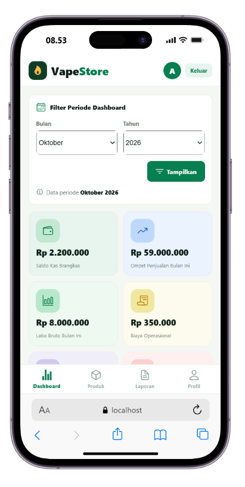
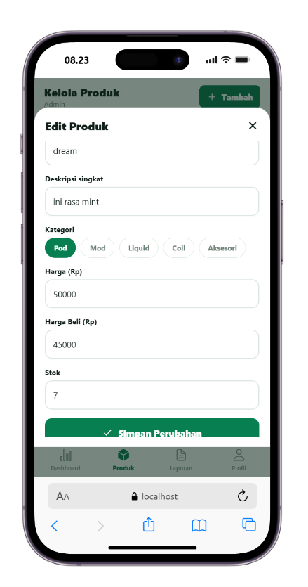
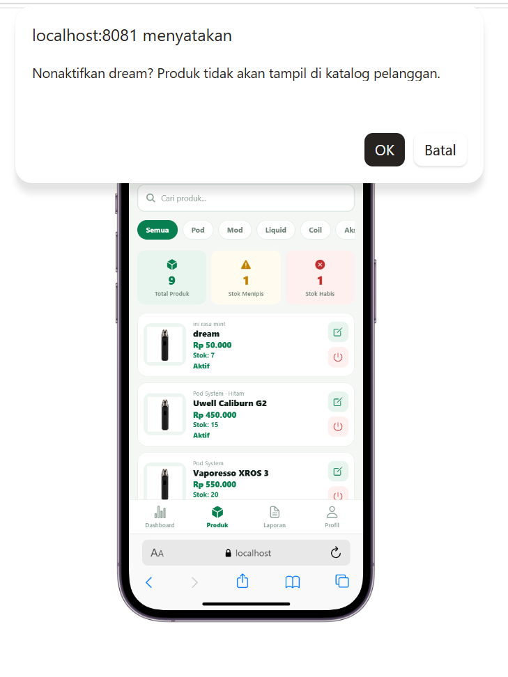
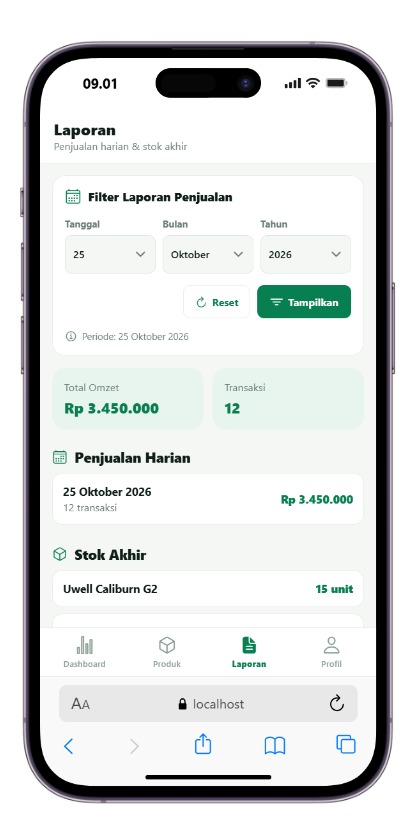

# Perbaikan UTS Kelompok 5

1. Role Admin untuk filter bulan dan tahun gunakan (format date (month dan year))

bukti:

2. Tambah field Harga beli pada tambah produk agar bisa digunakan ke Laporan Keuangan

bukti:

3. Filter pada Laporan Penjualan ada Tanggal, Bulan dan Tahun 

bukti:

