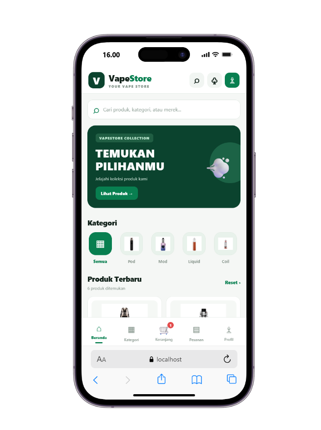
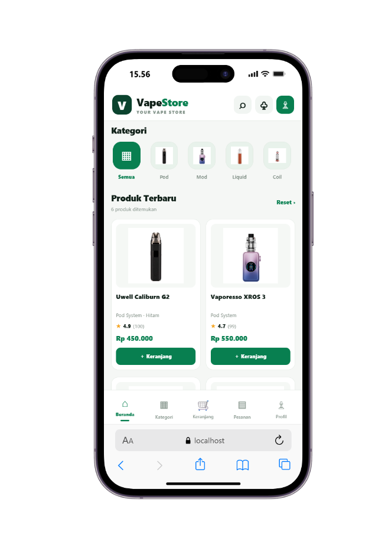
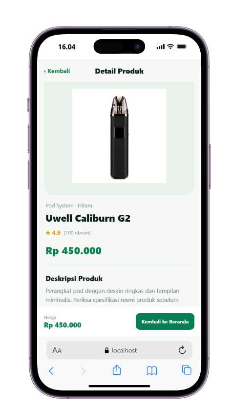
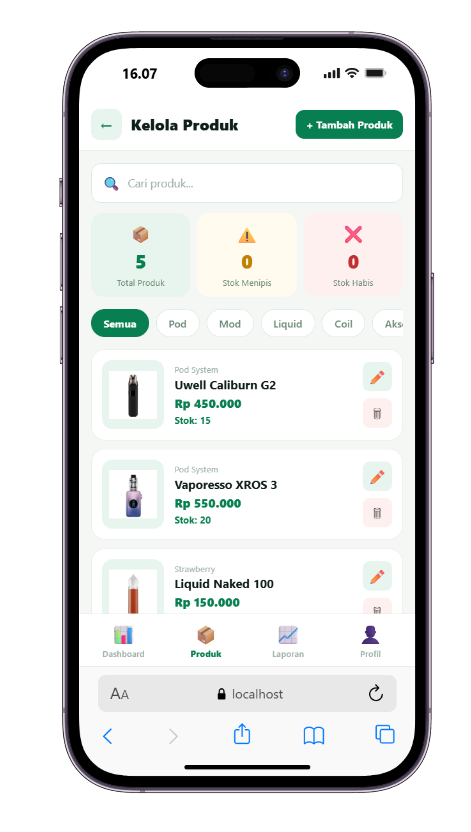

# Projek-kelompok-5
# VapeStore — Aplikasi Mobile E-Commerce

## 1. Deskripsi Aplikasi

VapeStore merupakan aplikasi mobile e-commerce yang dikembangkan menggunakan React Native dan Expo. Aplikasi ini dirancang untuk menampilkan katalog produk vape dengan tampilan yang sederhana dan mudah digunakan. Pengguna dapat melihat daftar produk, mencari produk, memilih kategori, melihat detail produk, dan menambahkan produk ke keranjang sesuai fitur yang telah diimplementasikan.

Aplikasi ini juga menyediakan fitur pengelolaan produk untuk mendukung pengelolaan katalog toko.

## 2. Daftar Screen dan Fitur UI

### 2.1 Dashboard
**Fitur UI:**
- Menampilkan banner aplikasi.
- Menampilkan kategori produk.
- Menyediakan kolom pencarian.
- Menampilkan daftar produk terbaru dan produk pilihan.
- Menyediakan navigasi ke halaman lainnya.
- Menampilkan indikator jumlah produk dalam keranjang jika tersedia.

**Screenshot:**



### 2.2 Katalog Produk
**Fitur UI:**
- Menampilkan daftar produk.
- Menampilkan gambar, nama, dan harga produk.
- Memudahkan pengguna memilih produk.

**Screenshot:**



### 2.3 Detail Produk
**Fitur UI:**
- Menampilkan informasi produk yang dipilih.
- Menampilkan gambar, nama, dan harga produk.
- Menyediakan tombol tambah ke keranjang jika sudah diimplementasikan.

**Screenshot:**



### 2.4 Keranjang
**Fitur UI:**
- Menampilkan produk yang telah ditambahkan.
- Menampilkan informasi produk dalam keranjang.
- Menyediakan kontrol jumlah atau penghapusan produk jika sudah tersedia.

**Screenshot:**


### 2.5 Login
**Fitur UI:**
- Menampilkan formulir masuk.
- Menyediakan kolom input sesuai desain yang dibuat.

**Screenshot:**


### 2.6 Register
**Fitur UI:**
- Menampilkan formulir pendaftaran pengguna.

**Screenshot:**


### 2.7 Kelola Produk
**Fitur UI:**
- Menampilkan antarmuka pengelolaan produk.
- Menyediakan kontrol pengelolaan produk sesuai fitur yang telah dibuat.

**Screenshot:**



## 3. Cara Menjalankan Proyek

### Persyaratan
- Node.js
- npm
- Expo
- Perangkat Android atau emulator, jika diperlukan

### Langkah Menjalankan
1. Clone repository proyek dari GitHub.
2. Buka terminal pada folder proyek yang berisi `package.json`.
3. Instal dependensi dengan perintah:

   ```bash
   npm install
   ```

4. Jalankan proyek dengan perintah:

   ```bash
   npx expo start
   ```

5. Buka aplikasi menggunakan Expo Go atau emulator yang sesuai dengan konfigurasi proyek.

**Catatan:** Pastikan terminal berada di direktori proyek yang benar sebelum menjalankan perintah.


## 4. Informasi Pengembang

**Nama aplikasi:** VapeStore  
**Teknologi:** React Native dan Expo  
**Kelompok:** Kelompok 5

1. Wahyu Ramdhani: Keranjang Checkout
2. Khajizatu Sidqiyah: katalog, kelola produk dan stok
3. Muhamad Zaki Abdul Khair: Login, register
4. Faqih huddin SM: Pengelolaan Pesanan


## 5. Informasi Pengembang

› Scan the QR code above to open in Expo Go.
› Metro: exp://10.170.23.44:8081
› Web: http://localhost:8081